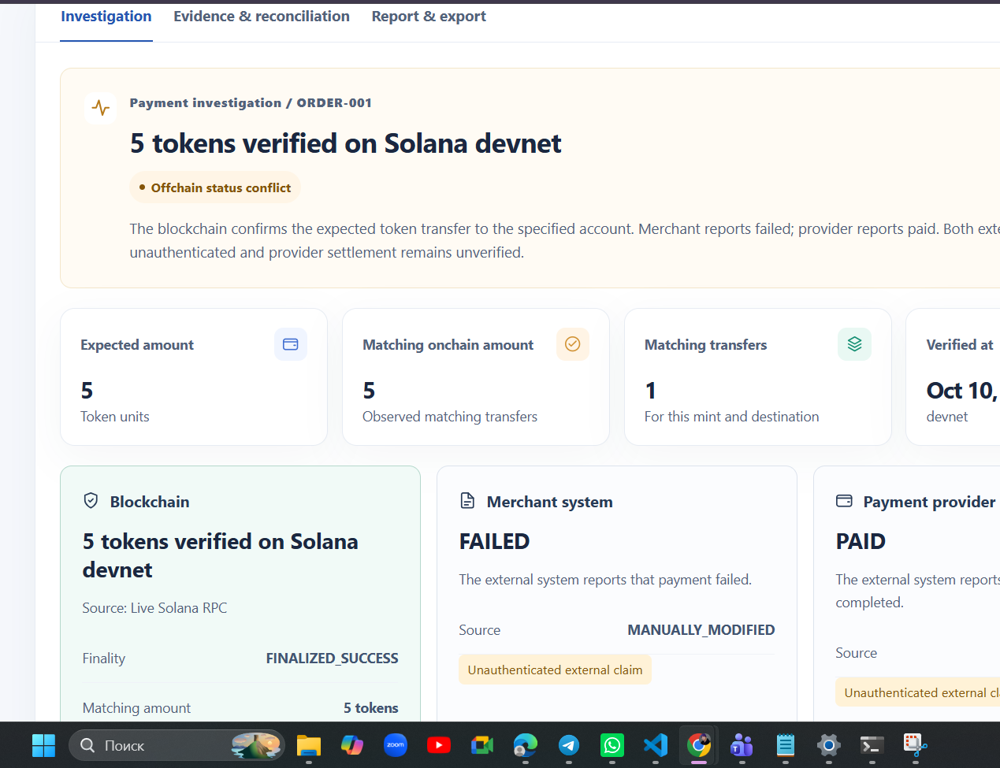

<div align="center">


# ChainCase

### Solana Payment Dispute Investigation

**The blockchain says paid. The merchant says failed. Who resolves the discrepancy?**

Verify onchain facts · Investigate conflicting payment records · Export evidence

    

[Why ChainCase](#the-problem) · [Live Proof](#real-devnet-proof) · [Features](#what-chaincase-does) · [Quick Start](#quick-start) · [Architecture](#architecture) · [Security](#security--limitations)

</div>

---

> **Colosseum Crypto World's Fair 2026 · Payments & Remittance**  
> ChainCase is an early-stage, **read-only investigation MVP**. It is **not** a payment gateway, custody service, provider integration, settlement certificate, or production-ready financial system.

## The problem

**A successful blockchain transfer does not guarantee that every business system records the payment consistently.**

Imagine a customer transfers tokens to the expected Solana token account, but the merchant's order system reports **FAILED**, while a payment provider's record reports **PAID**. The blockchain can establish whether a matching transfer occurred. It cannot, by itself, prove that a provider credited the merchant or that an order should be fulfilled.

Operations teams need to distinguish **independently verifiable onchain facts** from **external claims**, identify what disagrees, and document the next steps without guessing.

## The solution

**ChainCase turns a disputed Solana payment into a structured, evidence-based investigation.**

1. **Verify:** Inspect a real transaction through server-side Solana RPC.
2. **Compare:** Match the expected token mint, recipient **SPL token account**, and exact amount against the observed transfer.
3. **Reconcile:** Compare blockchain evidence with merchant/provider statuses supplied by a user or CSV/JSON import.
4. **Explain:** Flag mismatches and distinguish proven facts from unauthenticated external records.
5. **Export:** Generate a reproducible investigation package and printable evidence report.

## See ChainCase in action



*Actual ChainCase interface. The blockchain transfer was checked using live Devnet RPC; the merchant FAILED and provider PAID statuses were **manually supplied for demonstration**, not obtained from connected payment providers.*

| Resource | Link |
| :-- | :-- |
| **Verified Devnet transaction** | [View in Solana Explorer](https://explorer.solana.com/tx/2KY1P44tBb7SPaCWuZcYHMbPfyzs4yNFsfRgEq83Ma7Tz7jVks6XNYmeh7NyBKgdRkrpX8nbMv4ScsokHEmsRcVe?cluster=devnet) |
| **Live application** | Coming soon — deployment in progress |
| **Product demo video** | Coming soon |
| **Pitch video** | Coming soon |
| **Source code** | [hotsouse/chaincase-colosseum](https://github.com/hotsouse/chaincase-colosseum) |

## Real Devnet proof

A real, finalized SPL-token transaction was successfully verified in the ChainCase interface.

| Field | Verified demo value |
| :-- | :-- |
| Network | `devnet` |
| Order | `ORDER-001` |
| Expected amount | **5 test tokens** |
| Matching onchain amount | **5 test tokens** |
| Matching transfers | **1** |
| Finality | `FINALIZED_SUCCESS` |
| Verification source | **Live Solana RPC** |
| Merchant-reported status | `FAILED` — **manually modified** |
| Provider-reported status | `PAID` — **manually modified** |
| Finding | **Offchain status conflict** |

**Transaction signature:**

```text
2KY1P44tBb7SPaCWuZcYHMbPfyzs4yNFsfRgEq83Ma7Tz7jVks6XNYmeh7NyBKgdRkrpX8nbMv4ScsokHEmsRcVe
```

**Token mint:** `F5PfVvib1Skj7LZqNPP5ZWirdq4jaaG2Fz4fr37NVquq`  
**Recipient SPL token account:** `EqDkFinfZDw9VNNwZ3PhZjKGQXS8mgbqRJ4oZxCiXiB5`

> **Evidence boundary:** The live blockchain transfer is verifiable. The merchant and provider statuses in this scenario were manually entered; ChainCase does **not** independently authenticate them or establish provider settlement.

## What ChainCase does

| Capability | MVP implementation |
| :-- | :-- |
| Live blockchain verification | Solana JSON-RPC, `getTransaction` at `finalized` |
| Finality checks | `getSignatureStatuses` when needed |
| SPL transfer inspection | Parsed `transfer` / `transferChecked`, including parsed inner instructions |
| Exact token amounts | Raw-unit arithmetic using JavaScript `BigInt` |
| Expected vs. observed comparison | Mint, destination SPL token account, exact amount |
| Offchain reconciliation | Manually entered/imported merchant and provider statuses |
| Evidence provenance | Separates RPC-derived facts from external claims |
| Reports | JSON investigation package and printable report |
| Case history | Browser-local storage, no shared server database |
| Tests | Automated unit/API/mocked-RPC and smoke tests |

### Investigation outcomes

The analyzer distinguishes aligned external records, missing or contradictory external statuses, onchain mismatches, failed execution, transactions awaiting finality, and inconclusive RPC evidence. **An unavailable transaction is not automatically classified as a failed payment.**

## Quick start

**Requirements:** Node.js **20.11+** (Node.js 22 recommended), npm. The current MVP has no runtime package dependencies.

```bash
git clone https://github.com/hotsouse/chaincase-colosseum.git
cd chaincase-colosseum
npm start
```

Open **http://localhost:3000**.

**Run checks:**

```bash
npm test
npm run smoke
```

The automated tests use synthetic fixtures and mocked RPC responses; they do **not** independently establish live-network verification.

### Investigate a real transfer

1. Select **New case**.
2. Enter the order ID, merchant, transaction signature, network, expected SPL token mint, expected recipient **token account**, and amount.
3. Provide merchant/provider statuses, or select **Unknown**.
4. Select **Create & verify**.
5. Review **Investigation**, **Evidence & reconciliation**, and **Report & export**.
6. Export the JSON investigation package or print the report to PDF.

To explore without a transaction, use **Explore sample case**. Samples are explicitly marked **SIMULATION**.

**Example CSV:**

```csv
order_id,merchant_status,provider_status
ORDER-001,FAILED,PAID
```

The external statuses remain user-supplied claims even when imported from a file.

## Architecture

```text
Browser (HTML / CSS / ES modules)
  ├── Investigation UI and local case history (localStorage)
  ├── Deterministic reconciliation engine
  ├── JSON / printable reports and CSV import
  └── POST /api/verify
          │
          ▼
Native Node.js HTTP server
  ├── Input validation, request limits and RPC allowlist
  └── Solana JSON-RPC
        ├── getTransaction (finalized, jsonParsed)
        └── getSignatureStatuses (fallback)
```

**Why no smart contract?** ChainCase does not move funds or enforce payments. It verifies historical onchain evidence through the existing Solana ledger. An additional program is not necessary for this read-only MVP.

**Why browser-local storage?** It keeps the hackathon demo simple and requires no account. It is not appropriate for confidential production investigations or multi-user case management.

### API

`GET /api/health` — health response.  
`POST /api/verify` — verify a Solana transaction:

```json
{
  "network": "devnet",
  "signature": "<valid Solana transaction signature>"
}
```

The API returns transaction state, provenance, transfers and related evidence. Input errors, rate limits and RPC failures have distinct error responses.

## Security & limitations

- **Read-only:** no wallet connection, private keys, signing, custody, transfers, or automatic refunds.
- **Not audited:** do not use as a payment authorization, settlement, accounting, or legally conclusive dispute-resolution system.
- **No provider integrations:** merchant/provider statuses are user-entered or imported and not independently authenticated.
- **No identity proof:** a token transfer alone does not establish who paid or whether a merchant was credited.
- **No shared database:** case data is held in the browser's `localStorage`; clearing browser data removes local case history.
- **No confidential-data guarantees:** browser storage and unencrypted exports are unsuitable for sensitive production records.
- **Scope:** parsed SPL token transfers; native SOL payments and unusual token/accounting flows are outside the current implementation.
- **RPC dependency:** availability and historical results depend on the selected Solana RPC provider.

See [Security policy](docs/SECURITY.md), [Deployment notes](docs/DEPLOYMENT.md), and [Demo & pitch guide](docs/DEMO_AND_PITCH.md).

## Roadmap

**Future work, not current features:** authenticated merchant accounts, durable multi-tenant case storage, verified provider/webhook integrations, richer evidence trails, improved operational monitoring and production security review.

## License

MIT — see [LICENSE](LICENSE).

---

<div align="center">

**ChainCase · Verify the transfer. Explain the discrepancy.**

*Built for Colosseum Crypto World's Fair 2026. Not affiliated with or endorsed by Colosseum or Solana.*

</div>
